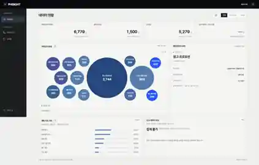
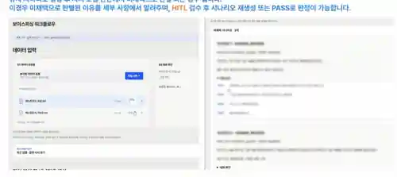

# EXEM 기업연계 프로젝트 | AI 워크플로우·LOOP 백엔드 개선

**2026.07~2026.10 · EXEM × ASAC · 5인 팀 · 공공기관 협업 과제**

공공기관의 피싱 공동대응을 지원하기 위해 보이스피싱·스미싱 사례를 검색·분류·생성·검수하는 워크플로우와 PHISIGHT 사용자 화면을 팀으로 구현했습니다. **화면 구현과 실제 분석 엔진 연동 검증은 별개**이며, 당시 엔진 연결 검증은 인증서 문제로 완료하지 못했습니다. [당시 UI 구현 상태](docs/ui-participation.md)에 상세히 기록했습니다.

**개인 담당:** 기존 eXemble의 LOOP 입력·출력 바인딩과 회차별 결과 전달 로직 개선, Python 코드·테스트 작성, 사내 PR 및 리뷰 대응. 사내 제품의 운영 배포나 설정 UI 연동까지 완료했다고 주장하지 않습니다.

**공개 코드의 범위:** [LOOP 엔진](backend/loop_demo/engine.py)·[HTTP API](backend/server.py)·[브라우저 화면](ui-demo/index.html)은 회사 원본을 공개한 것이 아니라 핵심 데이터 전달 동작을 합성 노드로 다시 구현한 **별도 예제**입니다. 해당 예제의 테스트 성공은 사내 제품의 통합 테스트와 구분합니다.

## 담당 업무

| 역할 | 해결한 문제 | 확인 자료 |
| --- | --- | --- |
| **LOOP 백엔드 개선** | 내부 노드의 여러 출력을 다음 회차에 구분해서 전달하기 어려움 | [기획·사내 PR·코드 리뷰](docs/development-review.md), [개선 과정](docs/loop-improvement.md), [독립 코드](backend/loop_demo/engine.py), [테스트](backend/tests/test_loop_engine.py) |
| **AI 데이터 품질 검수** | 음성인식 오류가 후속 검색·분류·생성에 영향을 줌 | [STT 검수 파이프라인](https://github.com/Westzer00/voice-phishing-stt-qc-pipeline) |
| **PHISIGHT UI 공동 개발** | 입력부터 분석·검수까지 사용자가 결과를 확인하는 과정 설계 | [UI 개인 기여](docs/ui-participation.md) |
| **AI 워크플로우 구현 참여** | 유사사례를 그대로 생성에 쓰면 부적절한 근거가 혼합될 수 있음 | [팀 워크플로우와 설계 판단](docs/team-workflow.md) |

## 1. LOOP에서 무엇을 개선했나

기존 LOOP는 내부 그래프를 반복했지만 **대표 결과 하나**를 중심으로 값을 전달했습니다. 내부 초안·검수 결과·근거를 다음 회차에 구분해 사용하기 어려워, 프롬프트보다 실행 구조의 문제를 먼저 해결해야 했습니다.

- 입력값을 한곳에서 지정하고 반복 중 공통으로 참조
- 필요한 내부 노드 결과에 이름을 붙여 출력
- **직전 성공 회차의 출력값**을 다음 회차에 전달
- 회차별 기록·최종 결과 저장, 출력값을 이용한 종료 조건
- 기존 기능 호환, 잘못된 참조·하위 노드 실패 및 중첩 데이터의 변경 방지 고려

상세 근거와 설계상 제약은 [LOOP 개선 문서](docs/loop-improvement.md)에 정리했습니다.

## 2. 팀 워크플로우의 설계 판단

단순한 ‘검색 → 생성’에서 **검색 결과 검수 → 생성 계획 → 생성 → 두 차례 검증**으로 개선했습니다. 비슷한 사례를 찾았다고 해서 생성에 적합한 근거인 것은 아니기 때문입니다.

[보이스피싱·스미싱 팀 워크플로우 정리](docs/team-workflow.md)

## 3. PHISIGHT 화면 개발

파일 등록부터 분석 요청·결과 검수까지의 사용자 흐름을 설계하고 상세 UI 구현에 공동 참여했습니다. 팀 최종 발표에서 사용한 PHISIGHT 화면을 아래에 소개합니다.

| 팀 시연 화면: 데이터 현황 | 팀 시연 화면: 사람 검토(HITL) |
|:---:|:---:|
|  |  |
| [화면 개요](docs/ui-participation.md) | 검수할 결과·판정 근거 확인 |

*팀 최종 발표 37·40페이지 화면. 검수 예시 문장 비식별화.*

[UI 담당 범위 및 구현 상태](docs/ui-participation.md)

## 4. LOOP 독립 실행 예제

LOOP의 **입출력 지정, 이전 회차 결과, 종료 조건**을 Python으로 구현한 독립 예제. 합성 노드로 실행하며 EXEM 내부 소스는 사용하지 않았습니다.

```bash
python -m pip install pytest
python -m pytest -q
python -m backend.examples.run_demo
python -m backend.server --port 8080
```

브라우저에서 http://127.0.0.1:8080 을 열면 합성 데이터 기반 웹 예제가 실행됩니다. [별도 브라우저 E2E 테스트](e2e/test_browser_ui.py)에서는 폼 입력부터 로컬 API 결과 표시·오류 처리까지 확인합니다.

- [LOOP 코드](backend/loop_demo/engine.py)
- [JSON 경로 처리](backend/loop_demo/bindings.py)
- [API와 웹 화면](backend/server.py)
- [자동 테스트](backend/tests/)

## 5. 파일 구조

```text
exem-ai-workflow/
├── README.md
├── backend/
│   ├── loop_demo/          # 독립 LOOP·출력 참조 로직
│   ├── examples/           # 합성 입력·실행 예시
│   ├── tests/              # 정상·예외·HTTP 검증
│   └── server.py           # 공개용 로컬 HTTP 서버
├── e2e/                    # 독립 웹 예제의 Chromium 브라우저 검증
├── ui-demo/                # PHISIGHT 원본이 아닌 LOOP 설명용 화면
├── assets/
│   ├── phisight-ui-overview.webp
│   ├── phisight-human-review.webp
│   └── README.md           # 이미지 출처·공개 범위
├── docs/
│   ├── development-review.md
│   ├── loop-improvement.md
│   ├── team-workflow.md
│   ├── ui-participation.md
│   ├── contribution.md
│   └── release-scope.md
└── .github/workflows/python-tests.yml
```

## 6. 자료 범위

기업 원본 코드·음성·문자 데이터·기관명은 제외하고, 독립 LOOP 예제와 최종 발표용 UI 화면만 사용했습니다. 예제 테스트와 기업 제품 운영 검증은 별개입니다.

[담당 범위](docs/contribution.md) · [자료 기준](docs/release-scope.md)
