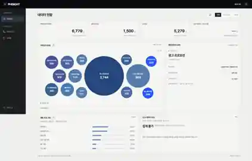
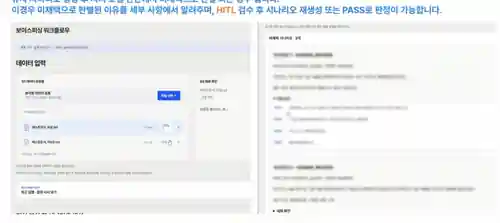

# PHISIGHT UI — 개인 참여와 구현 상태

## 직접 참여한 범위
- 초기 화면 구조와 정보 배치, 사용자 흐름 설계
- 데이터 입력부터 분석 결과·최종 검수까지의 화면 구성
- 초기 참고 화면을 제작하고 상세 UI를 팀원 1명과 공동 개발

## 최종 발표에 사용한 서비스 화면

팀 최종 발표 PDF 37~41페이지에는 메인·대시보드·HITL 검수·PASS 결과 화면이 있습니다. 아래에는 미리보기 2장을 선별해 게시했습니다. 데이터 원본과 협업 기관명은 포함하지 않았고, 검수 화면의 상세 예시 문장은 가렸습니다.

## 팀 저장소에서 확인한 기능
TXT·JSON 입력, 원문 확인, 보관함, 실행 요청, 결과 조회·다운로드, 실행 이력, 대시보드와 결과 비교 화면. Node.js 서버의 외부 워크플로우 호출 코드도 확인됐습니다.

## 구현 당시 상태
- 파일 등록, 실행 요청, 결과 조회와 다운로드, 이력 관리 화면 구현
- 4단계 진행 안내는 타이머 기반. 엔진의 실시간 단계 이벤트 연동은 진행 전
- 실제 분석 엔진의 연결 검증은 인증서 문제로 완료하지 못함
- 사용자 인증·접근 권한·마스킹 및 장기 운영 환경은 추가 연동 과제로 남음

## 별도 예제

저장소의 `ui-demo/`는 LOOP 회차별 결과를 표시하는 별도 웹 예제로, PHISIGHT 팀 서비스 UI와 구분됩니다.
